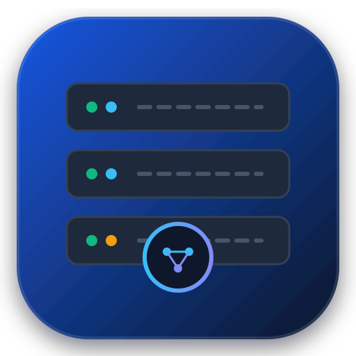

# Zima Host

<table>
  <tr>
    <th colspan="2" style="text-align: center;">
      <br />
      <b>Zima Host</b>
    </th>
  </tr>
  <tr>
    <td><b>Developer</b></td>
    <td>Yaroslav Solovev</td>
  </tr>
  <tr>
    <td><b>Platform</b></td>
    <td>ZimaOS / CasaOS (x86_64 / amd64)</td>
  </tr>
  <tr>
    <td><b>Category</b></td>
    <td>Self-hosted PaaS / Web Hosting Panel</td>
  </tr>
  <tr>
    <td><b>Core Components</b></td>
    <td>React, Express, SQLite, Docker, Caddy 2</td>
  </tr>
  <tr>
    <td><b>License</b></td>
    <td>MIT</td>
  </tr>
</table>

**Zima Host** is an open-source, zero-cost web hosting management platform designed for the ZimaBoard 2 running ZimaOS. It enables users to deploy, isolate, and route static and Node.js websites from a graphical interface, eliminating recurring cloud hosting fees and manual server configuration.

---

## 1. Overview & Architecture

Each project deployed through Zima Host runs in its own isolated Docker container on an internal bridge network (`zima-network`). Incoming web traffic is routed dynamically through a Caddy reverse proxy, which provisions and renews TLS/SSL certificates automatically via Let's Encrypt and ZeroSSL.

```
Public Internet (Cloudflare DNS / Tunnel)
                │
         [ Port 80 / 443 ]
                ▼
        ┌──────────────┐
        │   Caddy 2    │  ◄── Auto-configured via Zima Host API
        └───────┬──────┘
                │ Internal network (:3000, :8081, :8082...)
       ┌────────┴────────┬──────────────────┐
       ▼                 ▼                  ▼
┌──────────────┐  ┌──────────────┐   ┌──────────────┐
│  Zima Host   │  │ Static Site  │   │ Node.js App  │
│  (Port 3000) │  │ (Nginx Cont) │   │ (Node Cont)  │
└──────────────┘  └──────────────┘   └──────────────┘
```

---

## 2. Installation on ZimaOS

### Prerequisites
* A ZimaBoard running ZimaOS (or any Linux host with Docker installed).
* Root or sudo access on the board.

### Step 1: Transfer the project to your ZimaBoard
Clone the repository into `/DATA/AppData/zima-host/source`:

```bash
git clone https://github.com/soloiaros/zima-host.git /DATA/AppData/zima-host/source
cd /DATA/AppData/zima-host/source
```

*(Alternatively, copy `zima-host.zip` to your board via the ZimaOS Files app and extract it).*

### Step 2: Run the installer
Execute the setup script. On ZimaOS, root permissions and writable data paths are required:

```bash
sudo env DOCKER_CONFIG=/DATA/AppData/zima-host/.docker XDG_CONFIG_HOME=/DATA/AppData/zima-host/.config TMPDIR=/tmp bash scripts/install-zimaos.sh
```

### Step 3: Access the Management Panel
Open your browser to:
```
http://<zimaboard-ip>:3000
```
The Zima Host card will also appear on your ZimaOS home desktop.

---

## 3. Domain & Cloudflare Configuration

Zima Host integrates with domains managed under Cloudflare using two routing modes:

### Mode A: Cloudflare DNS (Direct A Record)
1. In your router, forward ports `80` and `443` to the ZimaBoard's local IP address.
2. In Cloudflare DNS, add an **A Record** (e.g. `example.com` or `*.example.com`) pointing to your home public IP with Proxy Status set to **Proxied** (Orange Cloud).
3. Inside the Zima Host panel, navigate to your project, open the **Domains** tab, and enter your domain name. Caddy will configure the route instantly.

### Mode B: Cloudflare Tunnel (No Port Forwarding Required)
For connections behind ISP CGNAT or where home router ports cannot be opened:
1. Create a free **Tunnel** in the Cloudflare Zero Trust dashboard.
2. Install the `cloudflared` Docker container on your ZimaBoard.
3. Configure your tunnel public hostname to forward traffic to `http://localhost:3000` (for the panel) or `http://localhost:80` (for Caddy).

---

## 4. Features & Components

* **Dashboard**: System telemetry gauges (CPU, memory, storage) and project status cards.
* **One-Click Deployments**: Git repository cloning and direct folder uploads for both static HTML/SPA and Node.js applications.
* **Process Isolation**: Every website runs inside its own Docker container with configurable environment variables.
* **Log Streaming**: Live stdout/stderr log viewer via WebSocket.
* **Automated Reverse Proxy**: Dynamic generation of Caddyfile entries with atomic zero-downtime reloads via Caddy's admin API.

---

## 5. Development

```bash
# Install dependencies
npm install

# Build all packages
npm run build

# Start dev server (Client: :5173, Server: :3000)
npm run dev
```

---

## 6. License

This project is licensed under the [MIT License](LICENSE).
